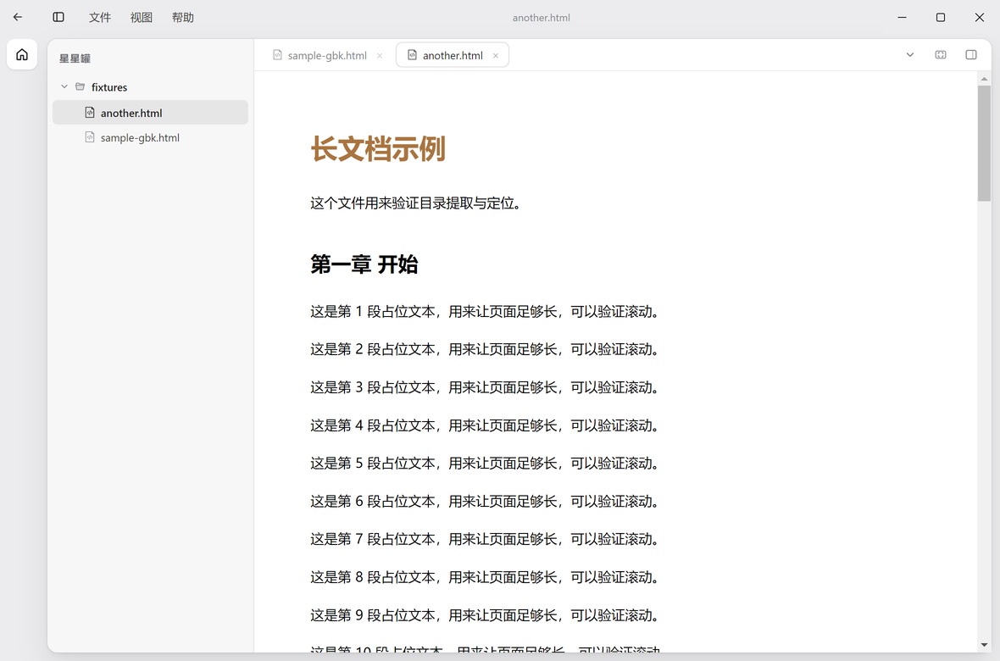

# Libra

本地 HTML 阅读器。把文件夹或单个 HTML 放进来，按浏览器渲染的样子读：左边文件树，中间正文，右边大纲，内容只读。



## 能做什么

- 打开文件夹：整棵目录进「星星罐」，磁盘上增删改名约 0.3 秒同步过来
- 打开单个 HTML：只加这一条，不展开它的同级目录
- 三栏布局：文件树、正文、大纲，两侧独立开关，分隔条可拖
- 页签：同时开多个文件，挤满后从右侧下拉里找
- 全屏阅读：只留网页，按 Esc 退出，窗口状态原样回来
- 编码保真：GBK、UTF-16、CRLF 按原样识别，不转码
- 右键重命名，改完页签和预览自动跟上

## 开始

Windows 双击 `启动Libra.cmd`，首次运行会自动装依赖。

也可以手动：

```bash
npm install
npm run dev
```

## 快捷键

| 操作 | Windows | macOS |
| --- | --- | --- |
| 打开文件 | Ctrl+O | ⌘O |
| 关闭页签 | Ctrl+W | ⌘W |
| 文件列表 | Ctrl+B | ⌘B |
| 大纲 | Ctrl+Shift+B | ⌘⇧B |
| 放大 / 缩小 / 原始大小 | Ctrl+= / Ctrl+- / Ctrl+0 | ⌘= / ⌘- / ⌘0 |
| 全屏 | F11 | ⌃⌘F |
| 退出全屏 | Esc | Esc |

## 打包

```bash
npm run dist:win    # Windows 安装包
npm run dist:mac    # macOS dmg + zip，必须在 macOS 上跑
npm run pack        # 只出免安装目录，用来快速试
```

产物在 `dist/`。macOS 包没有签名，第一次打开要在「系统设置 → 隐私与安全性」里放行。没有 Mac 怎么出包见 [docs/mac-build.md](docs/mac-build.md)。

## 平台

Windows 11 上开发和验证。macOS 已适配（自绘标题栏、红绿灯留位、⌘ 快捷键、Dock 图标），还没在真机跑过完整流程。Linux 没做。

## 开发

```bash
npm run typecheck
npm run build
npm test
npm run smoke
```

`npm run smoke` 启动真实应用跑一遍端到端检查。

设计取舍见 [docs/architecture.md](docs/architecture.md)，工程约定见 [AGENTS.md](AGENTS.md)。

## License

MIT
